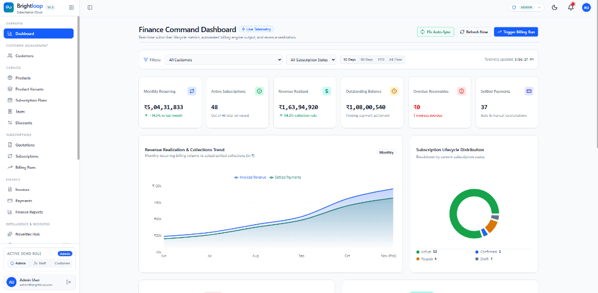
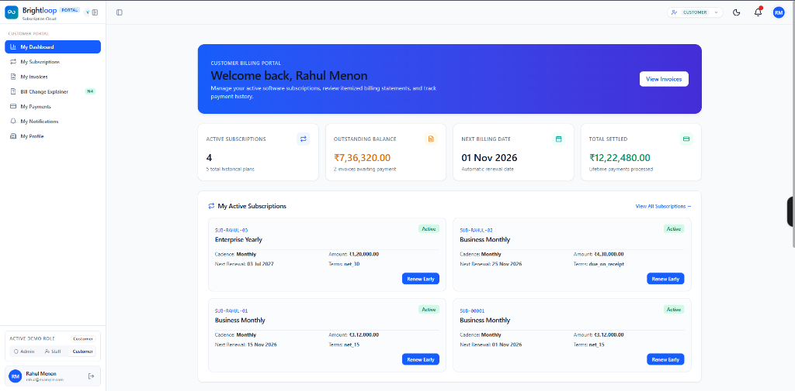
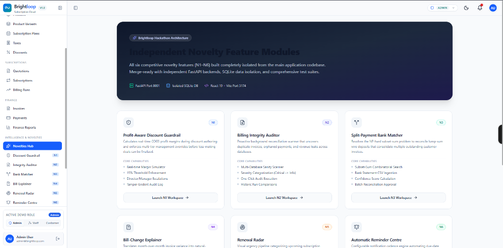

# RecurOps: Subscription Billing Platform for Software Companies

**RecurOps** replaces the spreadsheets, manual invoices and bank-statement matching that software companies use to run subscription revenue. One system covers the whole cycle: catalog, quotation, subscription management, billing, payments and reporting.

**First customer: Brightloop Software.** Brightloop sells software on monthly and yearly plans with add-ons and product variants. They came to us with five problems, and this repository is the platform that solves them.

| Brightloop's problem | What RecurOps does |
|---|---|
| Customer subscriptions live in a spreadsheet | One subscription record per customer with a Draft, Quotation, Confirmed, Active, Closed status flow the whole team can see |
| Renewals are missed | Renewal radar lists subscriptions expiring in 7, 30 and 60 days and creates a renewal quotation in one click |
| Invoices are typed by hand and often wrong | Invoices are generated automatically with taxes and discounts; running billing twice creates no duplicates |
| Payments are matched by scrolling bank statements | Payments are recorded against invoices; the bank matcher matches an uploaded bank CSV to open invoices |
| Nobody knows recurring revenue | Finance dashboard with active subscriptions, revenue, outstanding and overdue, fast at 10,000 subscriptions |



## Why a company would choose RecurOps

- **Money you can trust.** A database guard makes double billing impossible, and an integrity auditor proves it on demand.
- **Discounts that protect margin.** The discount guardrail shows the margin impact before an admin saves a rule.
- **Fewer support questions.** The bill explainer states in one sentence why an invoice changed.
- **Less chasing.** Reminder emails go out automatically, once each, before and after invoices are due.
- **Safe by design.** Admin, staff and customer roles are enforced on the server, and a customer can only ever see their own records.

## How it is delivered

Today each customer gets their own deployment: their own database, their own branding and their own users. Brightloop is the first deployment and is pre-loaded with demo data (10,000 subscriptions). More customers can be added in the same architecture with a clean multi-tenant foundation.


## Run the Brightloop deployment

```bash
# Backend (terminal 1)
cd backend
python -m pip install -r requirements.txt
python scripts/seed.py --reset 10000        # 10,000 subscriptions, about 5 seconds
python -m uvicorn app.main:app --port 8000  # API docs at http://localhost:8000/docs

# Frontend (terminal 2)
cd frontend
npm install
npm run dev                                 # open the URL it prints
```

The frontend talks to `http://localhost:8000/api` by default (override with `VITE_API_BASE_URL`).

| Role | Email | Password |
|---|---|---|
| Admin | admin@brightloop.com | AdminPassword@2026 |
| Staff | anjali@brightloop.com | StaffPassword@2026 |
| Customer | rahul@example.com | Brightloop@2026 |

## Features

**Platform (everything Brightloop's brief asked for)**

| Area | Capability |
|---|---|
| Accounts | Sign up with unique email and strong password rules, reset link, three roles, admin-only staff creation |
| Catalog | Products with cost price, variants (for example Odoo brand +560), plans (daily, weekly, monthly, yearly) with auto-close, closable, pausable and renewable rules |
| Sales | Quotation templates, numbered subscriptions, server-enforced status flow |
| Billing | Automatic invoices with tax rules, confirm / cancel / send / print, nothing billed twice or skipped |
| Discounts | Admin-only rules (fixed or percent, minimums, dates, usage limit) applied automatically and stopped at expiry or limit |
| Payments | Partial payments, paid vs outstanding, overdue detection |
| Reporting | Finance dashboard with filters, under 2 seconds at 10,000 subscriptions |
| Customer portal | Self-service view of their own subscriptions, invoices and payments |



**Our six differentiators**



| Novelty | Pain it removes | Where to find it |
|---|---|---|
| Discount guardrail | Unprofitable discounts given blindly without cost visibility | `/discount-guardrail` |
| Bill explainer | Customer confusion and support tickets over changed invoices | `/bill-explainer` |
| Integrity auditor | Silent revenue leaks, duplicate billing and orphan payments | `/integrity-auditor` |
| Bank matcher | Manual matching of lump-sum bank deposits against multiple invoices | `/bank-matcher` |
| Renewal radar | Contracts expiring unnoticed and unrenewed | `/renewal-radar` |
| Reminder centre | Unpaid and upcoming invoices requiring manual chasing | `/reminder-centre` |

### 1. Discount guardrail (/discount-guardrail)
**The pain:** Sales reps at Brightloop frequently offer discounts blindly to close deals without checking unit cost or margins. A 20% discount on a low-margin software add-on can easily turn a profitable deal into a loss.
**What we built:** We built an automated real-time margin simulator and multi-tier approval guardrail directly into discount authoring. It calculates true COGS profit margins before any discount is finalized.
**How it works:**
- Evaluates selling price, unit cost (COGS), discount type (percentage or fixed paise), and quantity.
- Computes net profit and post-discount margin against a configurable minimum margin floor (15.0%).
- Automatically determines required override tier: manager level if below 15%, or director level if margin drops below 5%.
- Persists every simulation and approval with justification in the `guardrail_audit_logs` database table.
**Try it:**
1. Log in as staff (`anjali@brightloop.com` / `StaffPassword@2026`) and navigate to **Discount Guardrail** (`/discount-guardrail`).
2. Set Base Sales Price to ₹1,000, Unit Cost to ₹800, and Discount to 15% (profit ₹50, margin 5.88%), triggering a breached guardrail warning.
3. Enter a business justification, click **Submit Override Request**, and observe the approved audit record appear in the live Audit Log.
**Why it matters:** Protects subscription gross margins and eliminates loss-making contracts before quotations ever reach customers.
**Proof:** `backend/tests/test_novelty_guardrail.py`, `backend/app/api/novelties/discount_guardrail.py`, `backend/app/services/guardrail_service.py`, `frontend/src/views/novelties/DiscountGuardrail.tsx`

### 2. Bill explainer (/bill-explainer)
**The pain:** Customers often receive a recurring bill that differs from the previous month and contact support because invoices look confusing or wrong. Support agents spend hours comparing line items to explain changes.
**What we built:** We built an automated diff engine that compares any two customer invoices and translates raw financial numbers into plain-English explanations. It identifies exactly which fields changed and why.
**How it works:**
- Fetches previous and current invoice records and item totals stored in integer paise.
- Computes exact arithmetic deltas across subtotal, tax amount, and discount amount.
- Evaluates line items to detect whether changes stem from plan revisions, quantity adjustments or tax recalculations.
- Generates a concise human-readable summary explaining the net price change and its underlying drivers.
**Try it:**
1. Log in as admin (`admin@brightloop.com` / `AdminPassword@2026`) or staff, and open **Bill Explainer** (`/bill-explainer`).
2. Select Previous Invoice (`inv-001`) and Current Invoice (`inv-002`) and click **Compare Invoices**.
3. Review the plain-English summary card showing the exact rupee delta and itemized explanations for subtotal and tax.
**Why it matters:** Resolves customer billing confusion immediately and drastically reduces billing-related support inquiries.
**Proof:** `backend/tests/test_novelty_bill_explainer.py`, `backend/app/api/novelties/bill_explainer.py`, `backend/app/services/bill_explainer_service.py`, `frontend/src/views/novelties/BillExplainer.tsx`

### 3. Integrity auditor (/integrity-auditor)
**The pain:** In fast-growing subscription billing, silent database anomalies like double-billed cycles, unbilled active periods or orphaned payments can go undetected for weeks. Manual spot-checking is too slow and unreliable.
**What we built:** We built an on-demand database integrity auditor that scans the live billing database for revenue leaks, duplicate invoices, and data mismatches. It flags critical issues with severity-level reporting.
**How it works:**
- Scans for duplicate invoices sharing the same subscription ID and overlapping billing periods (`critical` severity).
- Verifies that recorded invoice payments strictly equal the sum of successful payment records (`high` severity).
- Detects active subscriptions that have not been billed in over 35 days (`medium` severity).
- Identifies orphaned payment records referencing missing invoice IDs (`high` severity) and stores runs in `audit_runs`.
**Try it:**
1. Log in as admin (`admin@brightloop.com` / `AdminPassword@2026`) and click **Integrity Auditor** (`/integrity-auditor`).
2. Click **Run Integrity Audit** to trigger an automated database scan across all subscriptions, invoices and payments.
3. Filter findings by severity (Critical, High, Medium) and expand any item to inspect its affected IDs and diagnostic details.
**Why it matters:** Guarantees billing accuracy, prevents revenue leakage, and ensures full audit readiness on demand.
**Proof:** `backend/tests/test_novelty_auditor.py`, `backend/app/api/novelties/integrity_auditor.py`, `backend/app/services/auditor_service.py`, `frontend/src/views/novelties/IntegrityAuditor.tsx`.

### 4. Bank matcher (/bank-matcher)
**The pain:** Brightloop's finance team currently reconciles payments by manually scrolling through bank statements to match incoming wire deposits to open invoices. When a client sends a single lump-sum deposit that covers multiple invoices, the matching becomes tedious and error-prone.
**What we built:** We built an intelligent bank statement reconciliation tool powered by a subset-sum algorithm. It ingests standard bank CSV exports, extracts credit transactions, and automatically proposes invoice matches.
**How it works:**
- Parses bank statement CSV rows, converting credits to paise and saving them into `bank_transactions`.
- Queries open invoices with pending, partial, or overdue balances.
- Matches 1:1 exact invoice balances with 100% confidence.
- Runs a combinatorial subset-sum backtracking search (up to 4 invoices) to identify split payments summing exactly to the deposit.
- Persists approved reconciliations in `reconciliation_records` and marks transactions as matched.
**Try it:**
1. Log in as admin (`admin@brightloop.com` / `AdminPassword@2026`) and navigate to **Bank Matcher** (`/bank-matcher`).
2. Click **Load Sample Statement** (or upload your bank CSV) to ingest statement transactions.
3. Review the suggested subset-sum match combining multiple open invoices, check the matches, and click **Reconcile Selected**.
**Why it matters:** Eliminates manual statement cross-referencing and ensures split-payment deposits clear open invoices accurately.
**Proof:** `backend/tests/test_novelty_bank_matcher.py`, `backend/app/api/novelties/bank_matcher.py`, `backend/app/services/bank_matcher_service.py`, `frontend/src/views/novelties/BankMatcher.tsx`.

### 5. Renewal radar (/renewal-radar)
**The pain:** Subscription renewal dates at Brightloop are tracked informally, causing contracts to lapse unnoticed when staff forget to follow up. By the time the team realizes an agreement has expired, revenue is already at risk.
**What we built:** We built an early-warning renewal pipeline that groups expiring contracts into proactive operational horizons (7 days, 30 days, 60 days, and expired). It highlights customer names, plan details and upcoming renewals in one place.
**How it works:**
- Queries all active and expiring subscriptions with defined end dates.
- Computes exact days until expiration (`(end_date - today).days`) and partitions contracts into 7d, 30d, 60d, and expired buckets.
- Checks the database for existing draft or sent renewal quotations to prevent duplicate outreach.
- Generates 1-click renewal quotation drafts (`RenewalQuotation`) retaining original plan parameters and customer links.
**Try it:**
1. Log in as staff (`anjali@brightloop.com` / `StaffPassword@2026`) and click **Renewal Radar** (`/renewal-radar`).
2. Switch between the **7 Days**, **30 Days**, and **60 Days** tabs to inspect expiring subscriptions.
3. Click **1-Click Renewal Quote** on any subscription to generate a draft quotation instantly.
**Why it matters:** Maximizes net revenue retention by preventing accidental churn and accelerating customer renewals.
**Proof:** `backend/tests/test_novelty_renewal_radar.py`, `backend/app/api/novelties/renewal_radar.py`, `backend/app/services/renewal_radar_service.py`, `frontend/src/views/novelties/RenewalRadar.tsx`

### 6. Reminder centre (/reminder-centre)
**The pain:** Brightloop's staff spend hours each week manually drafting reminder emails to chase overdue invoices and warn customers about impending renewals. Customers often miss payments simply because no reminder was sent on time.
**What we built:** We built an automated notification engine with configurable timing rules for upcoming dues, overdue chasing, and renewal notices. It scans the database on schedule or on demand, generates reminders, and logs every dispatch.
**How it works:**
- Configures automated cadences: due-soon notices (e.g. 7, 3, 1 days before), overdue repeats (every 3 days), and expiry notices (30, 7 days).
- Scans active unpaid invoices and expiring contracts with registered customer email addresses.
- Applies a database-level unique constraint (`uq_reminder_dedup` on kind, entity_id, scheduled_at) preventing duplicate reminders.
- Logs every dispatch with delivery status (`sent`, `skipped`, `failed`), timestamps, and error messages in `reminder_records`.
**Try it:**
1. Log in as admin (`admin@brightloop.com` / `AdminPassword@2026`) and navigate to **Reminder Centre** (`/reminder-centre`).
2. Adjust the due-soon days or overdue repeat cadence and click **Save Cadence Settings**.
3. Click **Run Dispatch Now** to execute a live dispatch batch and inspect the dispatched count and history table.
**Why it matters:** Accelerates cash collections and eliminates manual chasing while ensuring customers receive consistent, non-intrusive notifications.
**Proof:** `backend/tests/test_novelty_reminder_centre.py`, `backend/app/api/novelties/reminder_centre.py`, `backend/app/services/reminder_centre_service.py`, `frontend/src/views/novelties/ReminderCentre.tsx`

## Architecture

| Layer | Technology |
|---|---|
| Backend | FastAPI, SQLAlchemy 2, Pydantic v2 |
| Database | SQLite in WAL mode with indexes; money stored as integer paise |
| Auth | JWT with bcrypt; roles checked on every request |
| Frontend | React 19, TypeScript, Vite, Tailwind |
| Quality | 60 automated backend tests; GitHub Actions CI |

## Roadmap

1. Multi-company hosting: one installation serving many customers, with isolated data per company.
2. Real email sending (today emails are written to an in-app outbox).
3. Online payment gateway and bank feed connections.
4. Offline-capable customer portal.
5. Customer-configurable branding.

## Team

Two developers, using feature branches and pull requests, with commits from both accounts.

## More documentation

- `backend/README.md`, `backend/API_DOCUMENTATION.md`: API reference
- `docs/api-contract.md`: frontend and backend contract
- `FRONTEND_MODULE_STATUS.md`: screens and the endpoints each uses

